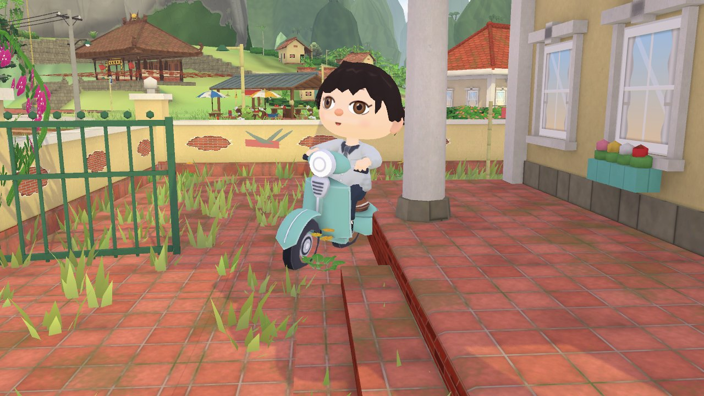
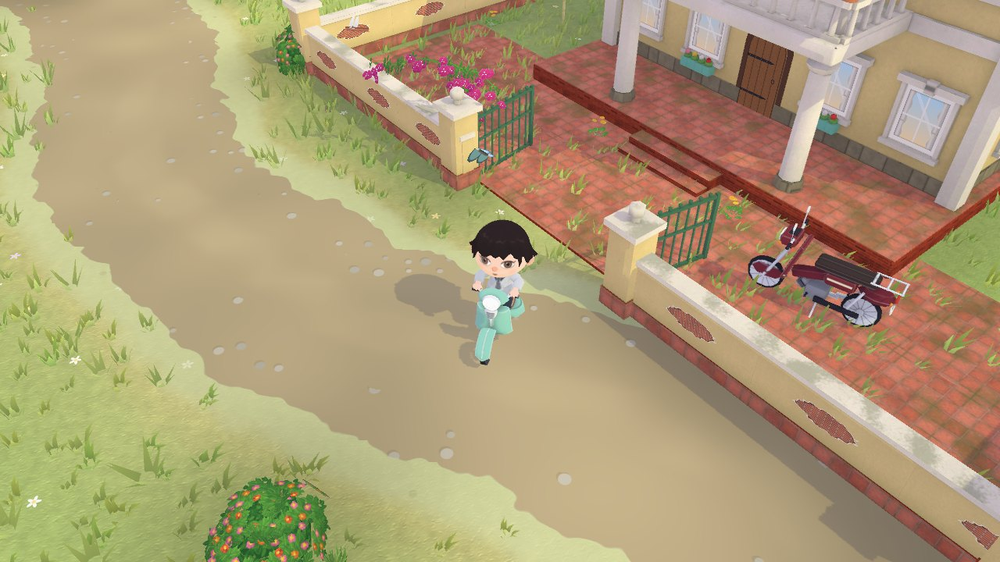
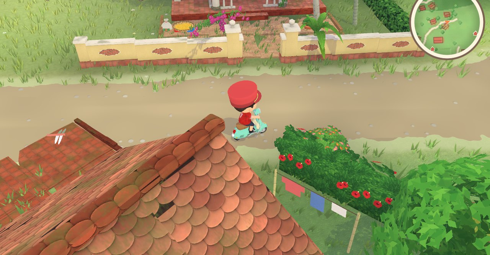
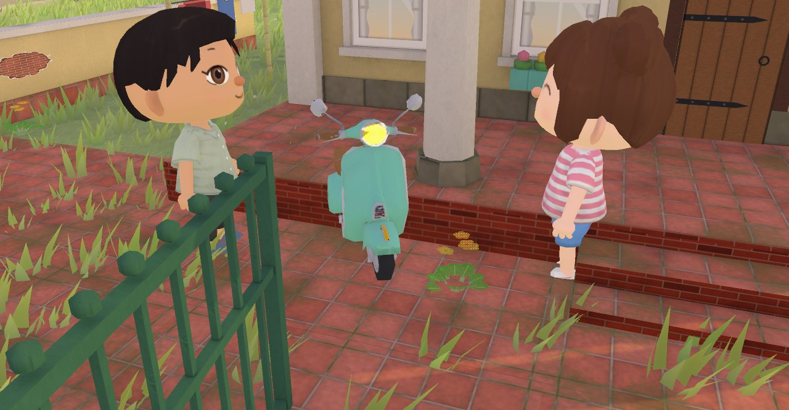
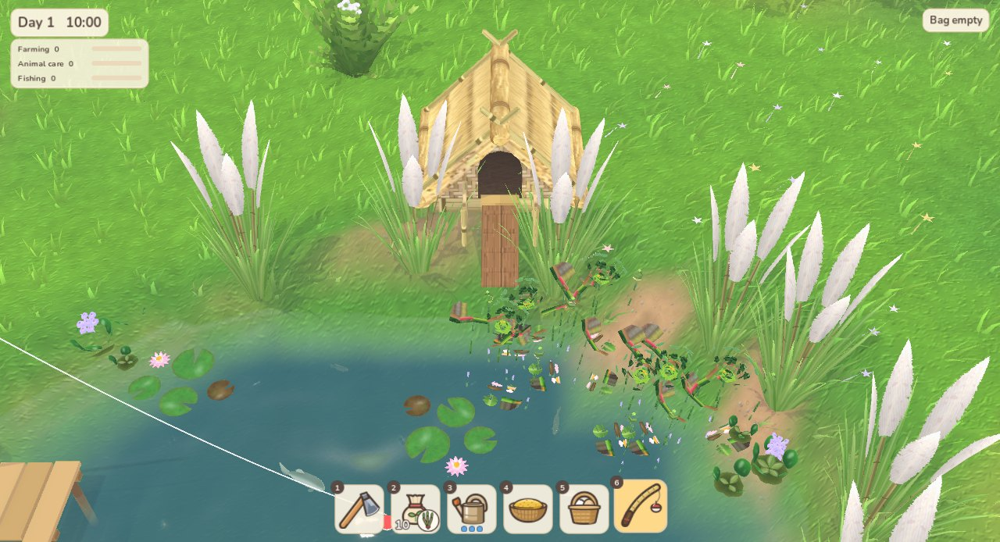
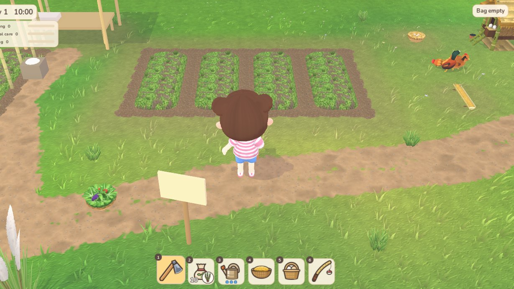
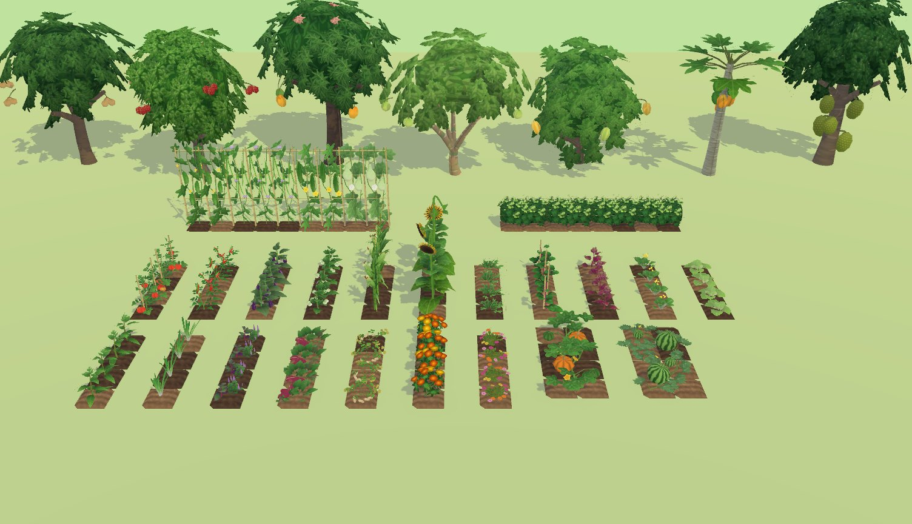
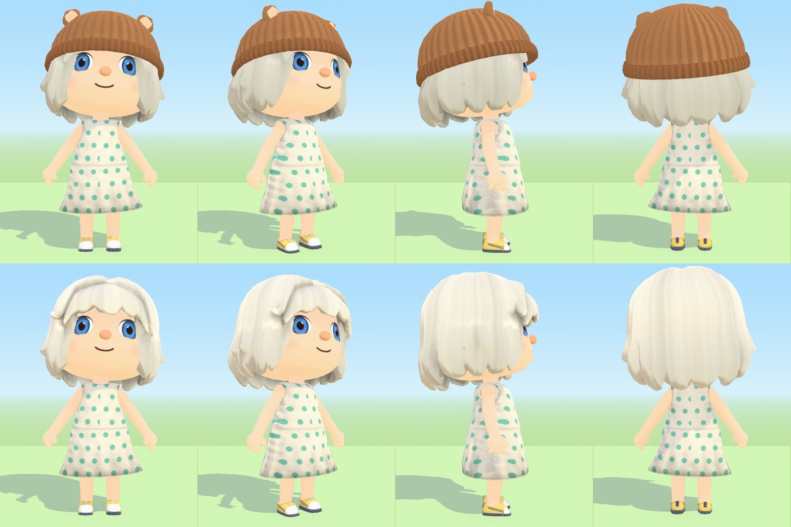
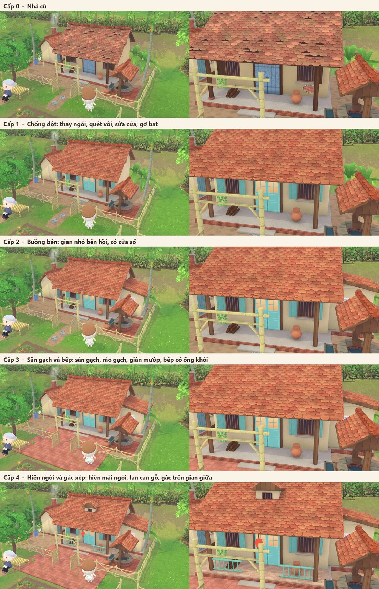

# Về Nhà — *Coming Home*

**A cozy 3D life-sim set in the countryside of northern Vietnam.**
Ride a Vespa down the village road, grow a garden, raise ducks and buffalo, fix up the family house and share the village with up to three friends online.

| | |
|:---:|:---:|
|  |  |
| *The village road* | *Riding under the tiled roofs* |
|  |  |
| *Back home with the family* | *Fishing by the duck pond* |
|  |  |
| *Working the vegetable plots* | *Fruit trees and crops* |

  
  

<b>Upgrading the family house, level by level</b>

---

## Under the hood

| | |
|---|---|
| **Engine** | Godot 4.7, customised build |
| **Native code** | C++17 GDExtension, 31 classes: hair and cloth physics, fish schooling and flocking, terrain meshing, chunked grass, time-of-day colour grading, saves and gameplay rules |
| **Rendering** | 65 hand-written shaders: toon lighting, water, rain, wind, sky and screen effects |
| **Online play** | Up to 4 players over UDP (ENet); single-player runs through the same code path |
| **Platforms** | Windows, iOS |

## About this repository

This is a **source-code showcase**: C++ (`cpp/`), GDScript (`scripts/`) and shaders (`shaders/`).
Art, models, audio, game data, tools and the engine build are **not included**, so the project does not run from this repository.

## License

© 2026 Nguyen Ngoc Thinh. All rights reserved.
The code is published for viewing only; no permission is granted to copy, modify or redistribute it.
