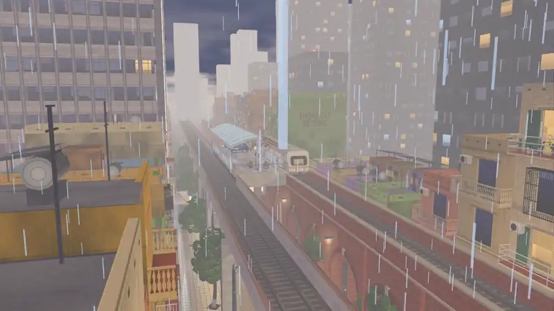

  

  
  
  
  
  

<i>
Bao năm chạy deadline, họp daily, fix bug lúc 2 giờ sáng. 
Một ngày đẹp trời, Sungha gập laptop, bắt xe về quê và quyết định: 
<b>từ nay không làm nô lệ cho tư bản nữa, về làm địa chủ!</b> 
(Địa chủ có mấy sào ruộng, một con Vespa cũ và một đàn mèo không nghe lời.)
</i>

### 🎬 Cutscene: Chuyến tàu về quê

  

<i>
Rời ga thành phố lúc trời mưa tầm tã, qua cây cầu sắt, đồng lúa có cò bay, con đò trên sông, thung lũng núi đá, 
chui qua hầm là thấy hoàng hôn quê nhà. Xuống ga Yên Khê, bố đã chờ sẵn bên chiếc xe máy. 
Không có ai nhắn "em ơi anh nhờ tí" trên suốt chặng đường.
</i>

<b><a href="docs/video/ve_nha_cutscene.mp4">▶ Xem bản đầy đủ (2 phút 18 giây)</a></b>

<i>Phương tiện di chuyển của địa chủ: Vespa đời cổ, đề ba lần mới nổ.</i>

<i>Ngày trước nhìn màn hình 8 tiếng. Giờ nhìn núi 8 tiếng. Mắt khỏe hẳn.</i>

<i>6 giờ chiều. Không ai nhắn "em ơi anh nhờ tí".</i>

<i>Gốc đa đầu làng: trụ sở chính của hội "nghe nói là...".</i>

<i>Dinh cơ địa chủ (của bố mẹ). Sửa dần, không vay ngân hàng.</i>

<i>Đầm sen. KPI duy nhất trong ngày: đi hết cây cầu.</i>

<i>Lúa chín vàng. Thưởng cuối năm lần này là thật, đong được bằng bao.</i>

<i>Ao vịt. Vịt không biết sprint là gì, và vịt rất hạnh phúc.</i>

<i>Làng Yên Khê: nơi wifi yếu nhưng tình làng nghĩa xóm full vạch.</i>

<i>Buổi sáng của địa chủ: dậy khi nào tùy thích, điểm danh cánh đồng.</i>

### Địa chủ cũng cần ăn diện, nuôi mèo và đi hội

<i>Tủ đồ địa chủ. Không còn sơ mi công sở nào.</i>

<i>Hội làng có múa lân. Đây là team building duy nhất mà ai cũng muốn đi.</i>

<i>Nhân sự trong làng. Không ai làm việc, nhưng ai cũng được nhận lương (cá khô).</i>

---

## Bên trong có gì

Địa chủ thì sống chậm, nhưng code thì phải chạy nhanh:

| | |
|---|---|
| **Engine** | Godot 4.7, bản build tự tùy biến |
| **Code native** | C++17 GDExtension, 31 class: vật lý tóc và vải, đàn cá bơi và chim bay theo bầy, dựng địa hình, cỏ chia theo ô, chỉnh màu theo giờ trong ngày, lưu game và luật chơi |
| **Đồ họa** | 65 shader viết tay: ánh sáng toon, nước, mưa, gió, bầu trời và hiệu ứng màn hình |
| **Thế giới** | Thung lũng 2 × 2 km nạp theo vùng, có ngày đêm và bốn mùa |
| **Chơi online** | Tối đa 4 người qua UDP (ENet). Rủ thêm ba đứa bạn về làm địa chủ cùng; chơi một mình cũng đi chung một luồng code |
| **Nền tảng** | Windows, iOS |

*Mọi ảnh ở trên đều do chính game render, không chỉnh sửa, không AI vẽ hộ.*

## Về repo này

Đây là repo **khoe code**: C++ (`cpp/`), GDScript (`scripts/`) và shader (`shaders/`).
Hình ảnh, model, animation, âm thanh, dữ liệu game, tool và bản build engine **không có ở đây**, nên clone về sẽ không chạy được đâu. Đất của địa chủ, không chia đâu nhé :))

## Bản quyền

© 2026 Nguyen Ngoc Thinh. Bảo lưu mọi quyền.
Code và hình ảnh chỉ để xem; không cho phép sao chép, chỉnh sửa hay phân phối lại.
