

  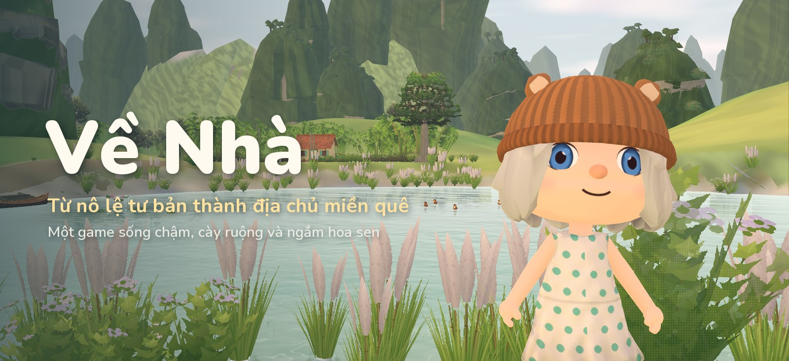

  
  
  
  

<i>
Sungha comes home to a little village tucked between limestone mountains. 
Ride the old Vespa past the rice fields, wander the lotus ponds, fix up the family house 
and share the village with up to three friends online.
</i>

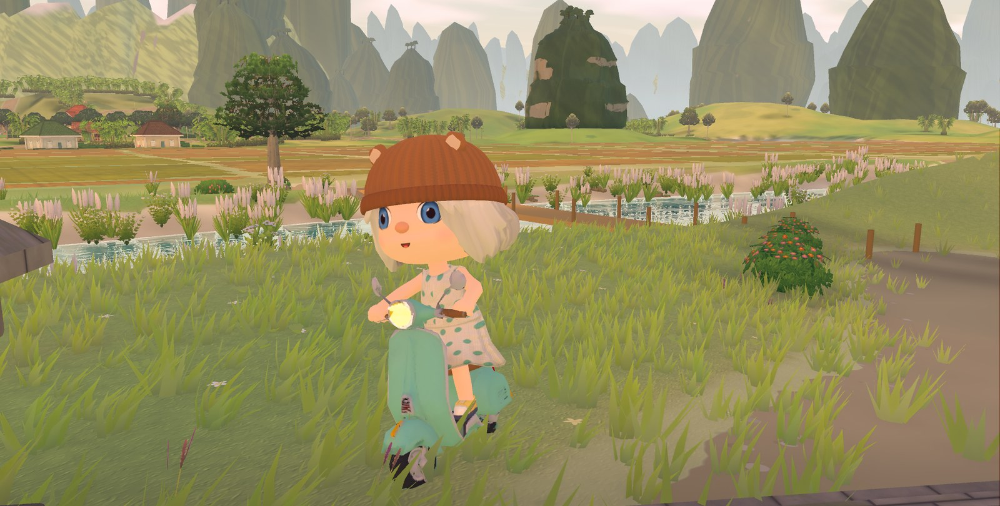

<i>Riding the old Vespa through the fields</i>

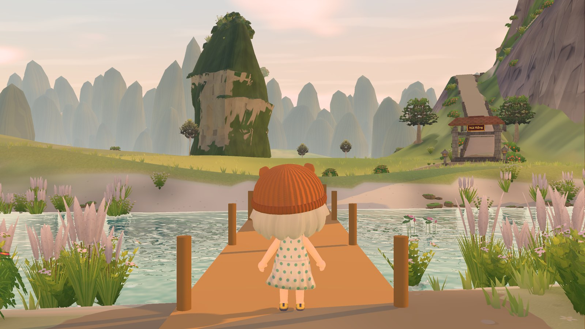

<i>Out on the pier, facing the mountains</i>

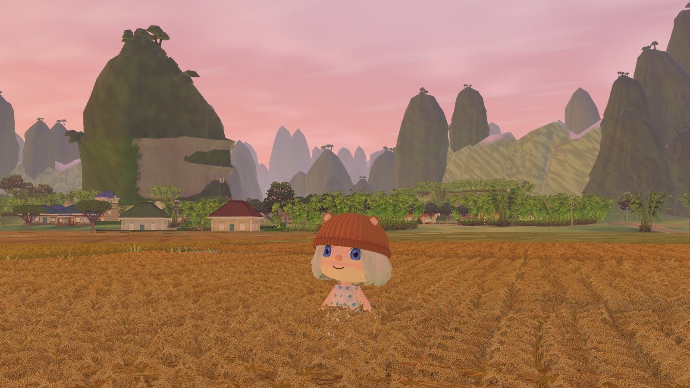

<i>The fields at dusk</i>

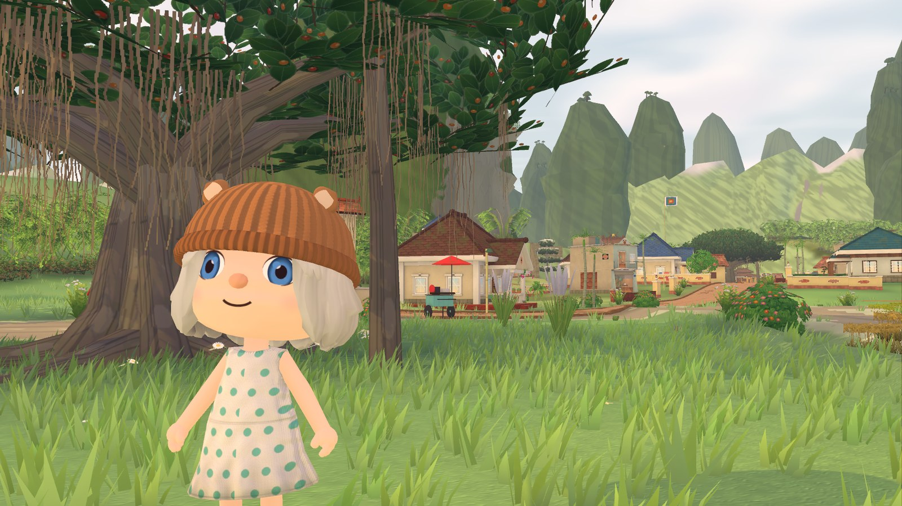

<i>Under the old banyan at the village gate</i>

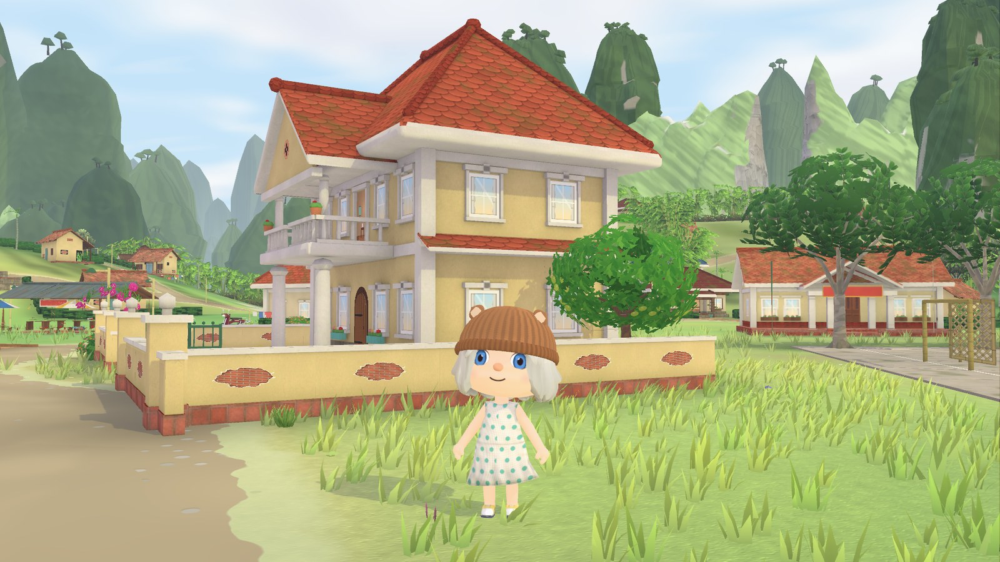

<i>Home, on a fresh morning</i>

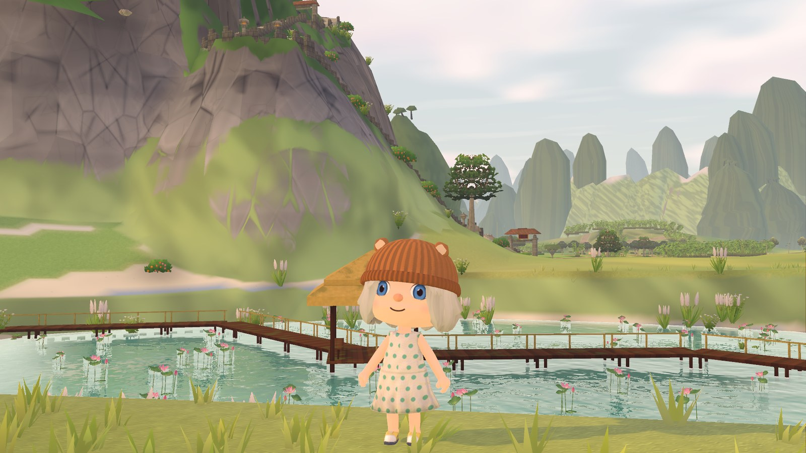

<i>The lotus pond boardwalk</i>

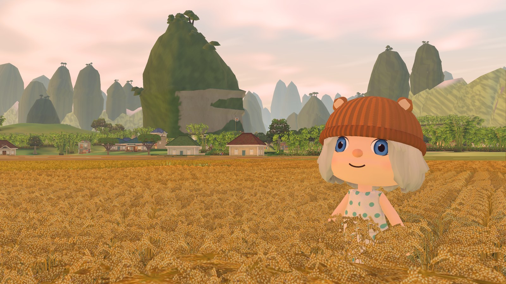

<i>Harvest-gold rice</i>

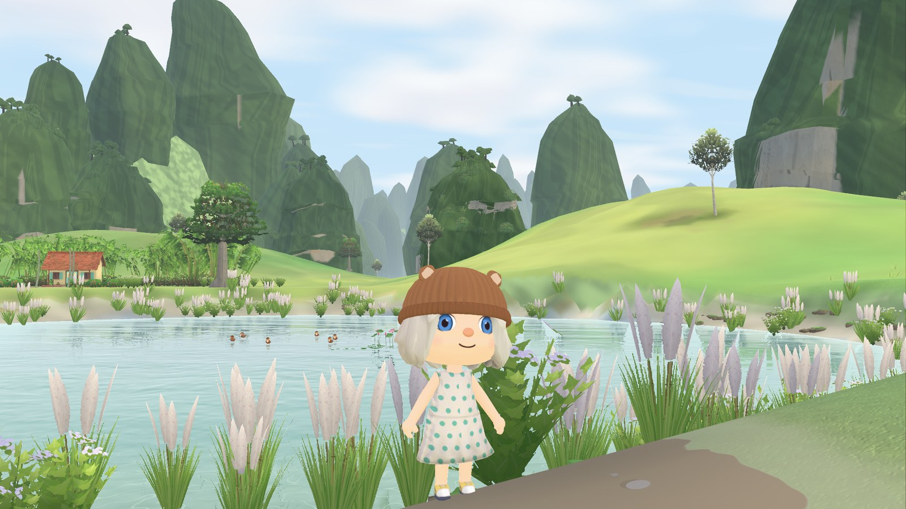

<i>Reeds by the duck pond</i>

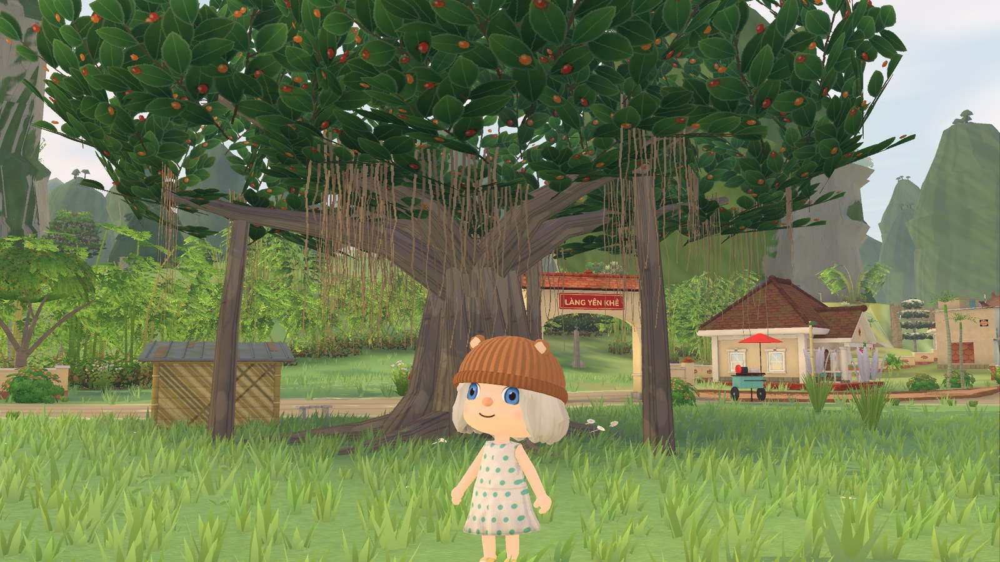

<i>Làng Yên Khê</i>

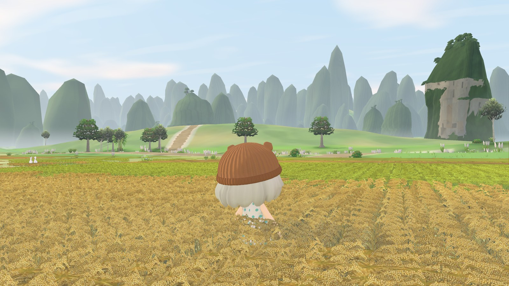

<i>Morning over the fields</i>

### Dress up, meet the animals, join the festivals

<i>Sungha's outfits</i>

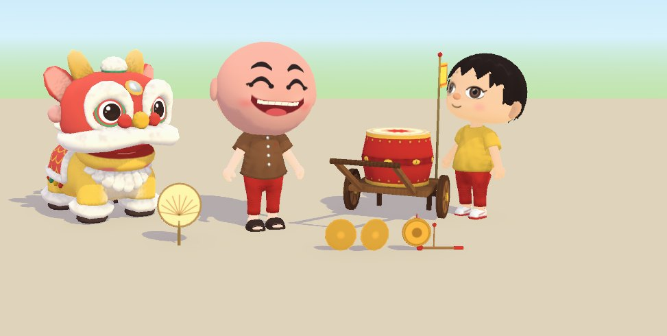

<i>The lion dance festival</i>

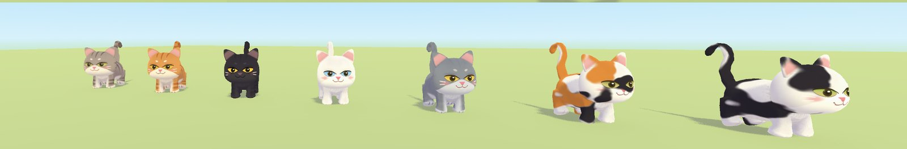

<i>The village cats</i>

---

## Under the hood

| | |
|---|---|
| **Engine** | Godot 4.7, customised build |
| **Native code** | C++17 GDExtension, 31 classes: hair and cloth physics, fish schooling and flocking, terrain meshing, chunked grass, time-of-day colour grading, saves and gameplay rules |
| **Rendering** | 65 hand-written shaders: toon lighting, water, rain, wind, sky and screen effects |
| **World** | A 2 × 2 km valley streamed by area, with a day–night cycle and seasons |
| **Online play** | Up to 4 players over UDP (ENet); single-player runs through the same code path |
| **Platforms** | Windows, iOS |

*Every screenshot above is an in-game capture, rendered by the game itself.*

## About this repository

This is a **source-code showcase**: C++ (`cpp/`), GDScript (`scripts/`) and shaders (`shaders/`).
Art, models, animations, audio, game data, tools and the engine build are **not included**, so the project does not run from this repository.

## License

© 2026 Nguyen Ngoc Thinh. All rights reserved.
The code and images are published for viewing only; no permission is granted to copy, modify or redistribute them.
